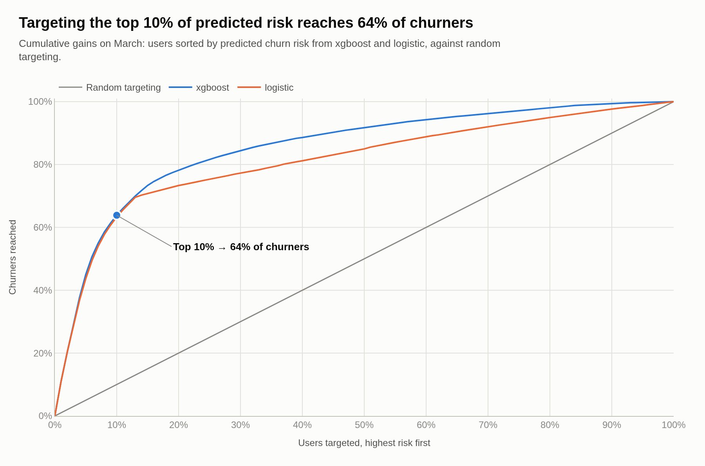
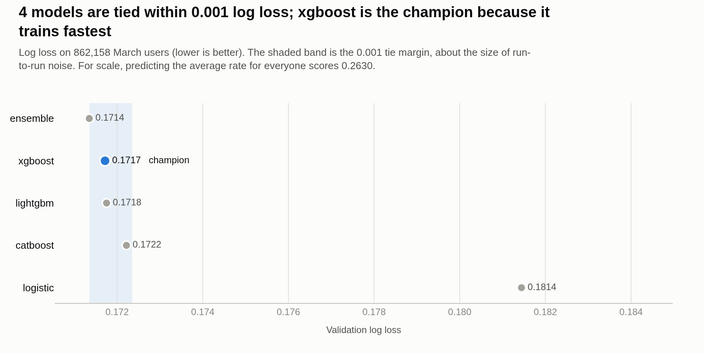
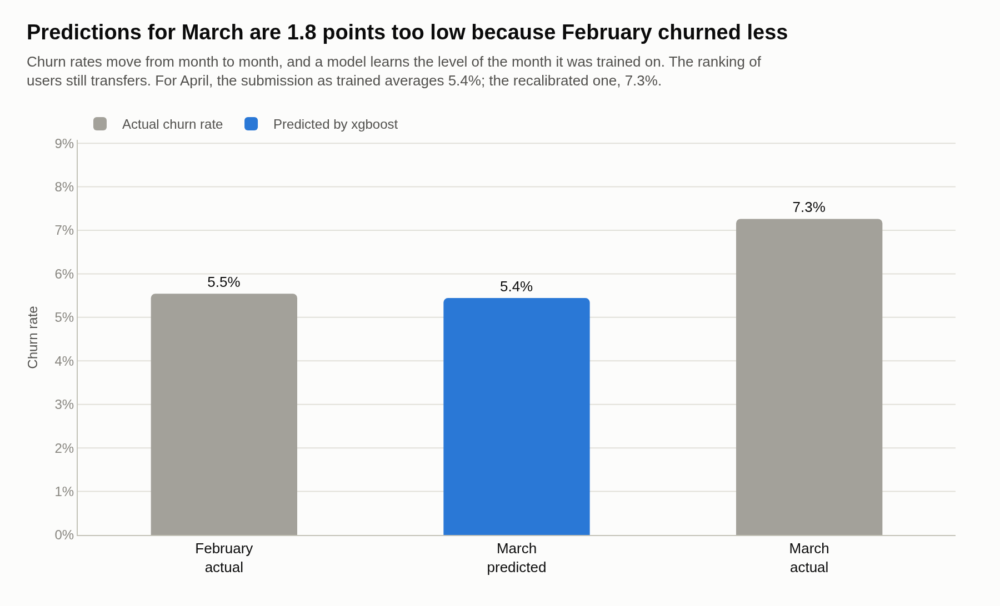
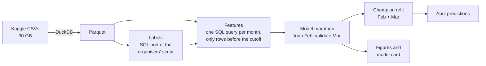

# KKBox Churn Prediction


Predicting which subscribers of KKBox, a music-streaming service, will not renew in the month their
membership expires. Built end to end on the 30 GB
[Kaggle WSDM challenge](https://www.kaggle.com/c/kkbox-churn-prediction-challenge) data: ingestion,
leak-proof features in SQL, a five-model comparison and out-of-time validation, with structured
logging throughout.

<picture>
  <source media="(prefers-color-scheme: dark)" srcset="docs/figures/cumulative_gains_dark.png">
  
</picture>

## Key findings

- **The top 10% of users by predicted risk contains 64% of the churners** in a month the model never
  saw (March 2017, 862,000 users). Log loss 0.172 against 0.263 for predicting the average rate.
- **Model choice barely matters here.** XGBoost, LightGBM, CatBoost and their ensemble finish within
  0.0008 log loss of each other, which is run-to-run noise. The pipeline therefore picks the quickest
  of the tied models rather than the nominal winner.
- **The level of the predictions matters more than the model.** February churned less than March, so
  every model under-predicts March by about 1.8 points. Matching March's rate would have improved log
  loss by 0.004, ten times the gap between models.
- **Re-deriving the labels did not help.** An exact SQL port of the organisers' labelling script does
  not reproduce their published labels, and training on rebuilt labels scored 0.04 worse.

<picture>
  <source media="(prefers-color-scheme: dark)" srcset="docs/figures/model_comparison_dark.png">
  
</picture>

<picture>
  <source media="(prefers-color-scheme: dark)" srcset="docs/figures/base_rate_shift_dark.png">
  
</picture>

More figures: [calibration](docs/figures/calibration_light.png),
[what drives predictions](docs/figures/feature_importance_light.png),
[the month-end effect](docs/figures/month_end_effect_light.png),
[label choice](docs/figures/label_choice_light.png).

## How it works



1. **Out-of-time validation.** Train on February 2017, validate on March, score April. Models are
   always tested on a later month than they learned from, as they would be in use.
2. **Leak-proof features.** Every feature comes from one SQL query that only reads rows dated before
   the snapshot's cutoff. A test proves that later rows cannot change a feature.
3. **A fair model comparison.** Every model is trained and scored the same way; early stopping uses a
   holdout of the training month, never the validation month.
4. **One log per run.** Every stage writes structured lines to a single `run.log` and a readable
   summary to the console (see [docs/LOGGING.md](docs/LOGGING.md)).
5. **Resumable.** Each finished model and final-fit seed is saved, so an interrupted run picks up
   where it stopped. Runs on a laptop, a server or Google Colab.

## Pipeline stages

| Mode | What it does | Main output |
|---|---|---|
| `ingest` | Kaggle → 7z → CSV → Parquet with DuckDB; trims the 30 GB listening log. `--tables` rebuilds chosen tables only | `data/processed/parquet/*.parquet` |
| `labels` | Rebuilds labels with an exact SQL port of the organisers' script (`jan`, `feb_rebuilt`) | `data/processed/parquet/labels_*.parquet` |
| `features` | One feature table per snapshot (`jan`, `feb`, `mar`, `apr`) | `data/processed/features/` |
| `diagnose` | Five checks on where accuracy is lost: within- against across-month, official against rebuilt labels, whether official labels were made too early, churn by segment, who is in each month | `runs/<run>/metrics/diagnostics_report.md` |
| `train` | Model marathon (prior, logistic, LightGBM, XGBoost, CatBoost and an ensemble), ranked on March; seed-averaged final fit; two submissions, as trained and recalibrated | `runs/<run>/artifacts/submission*.csv` |
| `all` | ingest, labels, features, train | |

## Quick start

Python 3.10 or later.

```bash
pip install -r requirements-dev.txt     # or requirements.txt to run without tests and linting
python scripts/doctor.py
python -m pytest

# Whole pipeline on synthetic data (no Kaggle account needed)
python main.py --mode all --demo --num_leaves 15 --min_data_in_leaf 20 --num_boost_round 500
```

Real data needs Kaggle credentials (see `.env.example`), the competition rules accepted, about 40 GB
of free disk and 12 GB of memory:

```bash
python main.py --mode all --raw_dir data/raw --data_dir data/processed --memory_limit 8GB
```

Rebuild the figures for a finished run, without retraining (interactive HTML in the run folder,
light and dark PNGs for this README):

```bash
python scripts/make_figures.py --run_dir runs/run_a --data_dir data/processed --export_dir docs/figures
```

Stages can be run separately into the same run folder:

```bash
python main.py --mode ingest   --run_dir runs/run_a
python main.py --mode labels   --run_dir runs/run_a
python main.py --mode features --run_dir runs/run_a
python main.py --mode diagnose --run_dir runs/run_a
python main.py --mode train    --run_dir runs/run_a
python main.py --mode train    --run_dir runs/run_a --models prior,lightgbm   # a smaller marathon
python main.py --mode train    --run_dir runs/run_a --tune                    # adds <model>_tuned entries
```

## Running on Google Colab

`notebooks/colab.ipynb` runs the same commands on Colab, one stage per cell, with processed data and
runs kept on Google Drive. `DEMO = True` runs everything on synthetic data first. The notebook is
generated by `scripts/build_notebook.py`.

## Run outputs

```text
runs/run_YYYYMMDD_HHMMSS/
├── logs/run.log
├── artifacts/   submission.csv, submission_recalibrated.csv, champion.json, model files,
│                marathon/ and final/ (saved results that a re-run reuses)
├── metrics/     summary.json, leaderboard, calibration and lift tables, SHAP importance
└── plots/       interactive figures (Plotly HTML)
```

The console shows a short, readable version of each step plus result tables; `run.log` keeps the full
structured lines. See [docs/LOGGING.md](docs/LOGGING.md). In a notebook, `display_run(run_dir)` from
`src/notebook_viewer.py` shows the saved ranking, diagnostics report and plots.

## Repository structure

```text
.
├── main.py                  # entry point: --mode ingest | labels | features | diagnose | train | all
├── src/
│   ├── logger.py            # setup_logger, log_stage, component_stage
│   ├── experiment.py        # run directories
│   ├── constants.py         # snapshots, cutoffs, table schemas
│   ├── db.py                # DuckDB / SQLite connection helpers
│   ├── ingest.py            # Kaggle download, 7z, CSV -> Parquet
│   ├── demo.py              # synthetic data generator
│   ├── labeller.py          # organisers' churn labeller, ported to SQL
│   ├── features.py          # cutoff-based feature SQL
│   ├── marathon.py          # model registry, tuning, ensemble, resume cache
│   ├── model.py             # runs the marathon, final fit, submissions
│   ├── evaluate.py          # metrics, calibration, lift
│   ├── figures.py           # results figures (Plotly), light and dark
│   ├── diagnostics.py       # where accuracy is lost (--mode diagnose)
│   ├── console.py           # readable console output
│   ├── notebook_viewer.py   # display_run(run_dir) for notebooks
│   └── storage.py           # feature table read/write
├── scripts/                 # doctor.py, make_figures.py, build_notebook.py
├── notebooks/               # colab.ipynb
├── tests/                   # unit tests and end-to-end runs on synthetic data
└── docs/                    # LOGGING.md, MODEL_CARD.md, DATA_CARD.md, FIGURES.md, figures/, results/
```

## Results

Trained on February 2017 official labels, validated on March 2017 (expiry population: 7.26% churn).
Log loss is the competition metric; lower is better.

| Model | Valid log loss | Valid AUC | Mean prediction | Top 10% capture | Kaggle private LB |
|---|---|---|---|---|---|
| ensemble (XGBoost, LightGBM, CatBoost) | **0.1714** | **0.884** | 5.45% | 63.9% | |
| xgboost | 0.1717 | 0.883 | 5.44% | 63.9% | |
| lightgbm | 0.1718 | 0.883 | 5.43% | 63.9% | |
| catboost | 0.1722 | 0.882 | 5.49% | 63.6% | |
| logistic | 0.1814 | 0.838 | 5.55% | 63.3% | |
| prior | 0.2630 | 0.500 | 5.54% | 9.8% | |

- The four boosted entries are within 0.0008 of each other, which is run-to-run noise. Within that
  margin (`--champion_tolerance`, 0.001) the quickest model to train is the champion, so XGBoost.
- Every model predicts about 5.4% churn against March's 7.3%, because February churned less. Matching
  March's rate would have given 0.1673, a gain about ten times larger than any model choice (an upper
  bound: it uses March's own rate). `submission_recalibrated.csv` tests that correction on April.
- Training on labels rebuilt with the organisers' script did worse on the official March labels
  (LightGBM 0.2138, or 0.2123 with January added), so the official February labels are the default.

See [docs/MODEL_CARD.md](docs/MODEL_CARD.md) and [docs/DATA_CARD.md](docs/DATA_CARD.md).

## Data

The KKBox data is not included and must not be committed. See [docs/DATA_CARD.md](docs/DATA_CARD.md).

## License

MIT. See [LICENSE](LICENSE).
